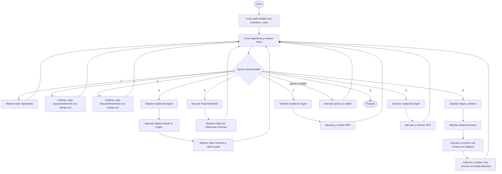

# Diagramas del sistema de rutas

Los siguientes diagramas documentan las clases y el flujo de las opciones
implementadas en `Main`.

## Diagrama de clases

```mermaid
classDiagram
    class Main {
        +main(String[] args)
        -crearGrafo() Grafo
        -mostrarMenu()
        -consultarRuta(...)
        -consultarDesdeOrigen(...)
        -ejecutarBfs(...)
        -ejecutarDfs(...)
    }

    class Grafo {
        +INFINITO: int {static}
        -String[] ciudades
        -int[][] costos
        -List~Ruta~ rutas
        +Grafo(String... ciudades)
        +agregarArista(int origen, int destino, int costo)
        +getCantidadCiudades() int
        +getNombreCiudad(int indice) String
        +getCosto(int origen, int destino) int
        +existeArista(int origen, int destino) boolean
        +getRutas() List~Ruta~
    }

    class Ruta {
        -int origen
        -int destino
        -int distancia
        +getOrigen() int
        +getDestino() int
        +getDistancia() int
    }

    class Dijkstra {
        +calcular(Grafo grafo, int origen) ResultadoDijkstra
    }

    class ResultadoDijkstra {
        -int origen
        -int[] distancias
        -int[] predecesores
        -List~Estado~ estados
        +getDistanciaHasta(int destino) int
        +getRutaHasta(int destino) List~Integer~
        +getEstados() List~Estado~
    }

    class Estado {
        -int ciudadSeleccionada
        -int[] distancias
        -int[] predecesores
    }

    class FloydWarshall {
        +calcular(Grafo grafo) ResultadoFloydWarshall
    }

    class ResultadoFloydWarshall {
        -int[][] distancias
        -int[][] siguiente
        -List~Actualizacion~ actualizaciones
        +getDistancia(int origen, int destino) int
        +getRuta(int origen, int destino) List~Integer~
    }

    class Actualizacion {
        -int ciudadIntermedia
        -int origen
        -int destino
        -int distanciaAnterior
        -int distanciaNueva
    }

    class BusquedaAnchura {
        +recorrer(Grafo grafo, int origen) List~Integer~
    }

    class BusquedaProfundidad {
        +recorrer(Grafo grafo, int origen) List~Integer~
    }

    class OrdenadorRutas {
        +ordenar(List~Ruta~ rutas, boolean ascendente) List~Ruta~
    }

    Main ..> Grafo : crea y consulta
    Main ..> Dijkstra : usa
    Main ..> FloydWarshall : usa
    Main ..> BusquedaAnchura : usa
    Main ..> BusquedaProfundidad : usa
    Main ..> OrdenadorRutas : usa
    Grafo "1" o-- "0..*" Ruta : registra
    Dijkstra ..> Grafo : calcula sobre
    Dijkstra ..> ResultadoDijkstra : produce
    ResultadoDijkstra "1" *-- "0..*" Estado : conserva
    FloydWarshall ..> Grafo : calcula sobre
    FloydWarshall ..> ResultadoFloydWarshall : produce
    ResultadoFloydWarshall "1" *-- "0..*" Actualizacion : conserva
    BusquedaAnchura ..> Grafo : recorre
    BusquedaProfundidad ..> Grafo : recorre
    OrdenadorRutas ..> Ruta : ordena
```

## Diagrama de flujo


